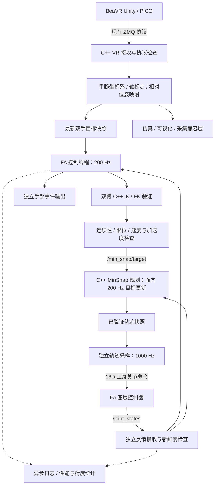

# FA 遥操作 C++ 重构架构方案

日期：2026-10-13

状态：经用户确认的重构前设计。代码实现已经落地；实际接口与测试结论分别见 [部署文档](docs/DEPLOYMENT_ZH.md) 和 [验证报告](docs/VALIDATION_ZH.md)。

本方案基于对当前源代码、配置及本地依赖的只读检查。文中的现状数值是源码配置值，不代表已经测得的机器人运行性能。

## 1. 目标、范围与目录约束

将 FA 双臂遥操作的机器人侧关键链路迁移到 C++，以 **200 Hz 控制更新、末端位置误差 1 mm、末端姿态误差 0.01 rad** 为设计和验收目标。

- 原目录 `/home/likunwei/dataCollection` 中的代码全部保持原样；不在该目录切换分支、生成构建产物或执行会写缓存的测试。
- 在独立目录 `/home/likunwei/VRTeleoperation-cpp` 中准备新仓库、复制源码、重构、构建和验证。
- 将 BeaVR 相关源码一起复制并上传，包括 `beavr-bot/`、`BeaVR-app/` 和链路需要的 `televuer/`，保留现有目录名称。
- 目标仓库：<https://github.com/ROS-LiKunwei/VRTeleoperation>；目标新分支：`C++`。
- 复制本地当前源码内容，包括必要的未提交修改；不能只依靠远端 `main`，否则可能遗漏本地 FA 功能。
- 上传源码、配置、机器人模型和必要资源；虚拟环境、数据集、日志、Unity Library、构建缓存等不进入分支。
- 本次实现阶段完成离线和仿真验证，真实机器人启动由用户执行；交付可复制的运行与验收命令。

**C++ 迁移范围**：VR 数据接收、关键点到手腕坐标系的转换、FA 轴标定、相对位姿映射、会话状态机、双臂 IK 调度、安全限幅、ROS 2 控制接口和性能诊断。

Unity 前端继续使用 C#。Python 版 BeaVR 随仓库保留，用于行为对照、现有采集工具及兼容接入。C++ 实时控制路径不依赖 Python 解释器。

## 2. 当前链路与已确认的限制

当前机器人侧的主要调用链为：

```text
BeaVR Unity / PICO
    ↓ ZMQ，双手关键点与按钮/暂停事件
pico4.py
    ↓ Python InputFrame
keypoint_transform.py
    ↓ 手腕坐标系
fa_operator.py（复用 XArmOperator）
    ↓ 机器人末端目标
fa_real_control.py
    ↓ 调用 ik_7dof_pybind，生成双臂关节目标
/min_snap/target
    ↓ C++ MinSnap 规划与采样
/upper_position_controller/commands
    ↓
机器人底层驱动
```

| 环节 | 已检查到的配置或实现 | 对新目标的影响 |
|---|---|---|
| Unity | `GestureDetectorXR.cs` 中目标应用帧率字段默认 60，Inspector 范围 30～90；有重复帧抑制 | 必须实测新传感器帧率；应用配置值不等于传感器采样率 |
| Python VR 接收 | `robots.VR_FREQ = 90` | 现有处理循环设为 90 Hz |
| FA 控制循环 | `command_publish_hz = 100` | 现有循环设为 100 Hz |
| MinSnap 目标发布 | `min_snap_target_publish_hz = 60` | 存在额外的目标发布限频 |
| 位置/姿态死区 | `0.01 m / 0.015 rad` | 10 mm 的位置死区与 1 mm 目标冲突 |
| FA IK 质量上限 | `0.06 m / 0.12 rad` | 容许误差远大于新的精度目标 |
| IK 可接受近似解 | `0.02 m / 0.05 rad` | 近似解不能作为 1 mm 达标依据 |
| MinSnap | 输出设为 1000 Hz，`min_replan_interval_s = 0.016` | 高频采样不代表高频接收新目标；重规划频率约受限于 62.5 Hz |
| 仿真反馈 | FA 默认镜像配置中 `/joint_states` 发布设为 50 Hz | 仿真验收也需要专门配置反馈频率 |
| IK 内核 | 已经是基于 Eigen/Pinocchio 的 C++ 库 | 优先直接链接并优化现有库，保留运动学定义 |

上述设置主要位于：

- [FA 默认配置](/home/likunwei/dataCollection/beavr-bot/src/beavr/teleop/configs/robots/fa_config.py:119)
- [VR 处理频率](/home/likunwei/dataCollection/beavr-bot/src/beavr/teleop/configs/constants/robots.py:169)
- [FA 控制循环](/home/likunwei/dataCollection/beavr-bot/src/beavr/teleop/components/interface/robots/fa_real_control.py:606)
- [Unity 手势与发送逻辑](</home/likunwei/dataCollection/BeaVR-app/BeaVR-Unity/Assets/Scripts/Gesture Detection/GestureDetectorXR.cs:145>)
- [本地 MinSnap 配置](/home/likunwei/humanoid_ws/src/min_snap/config/min_snap.yaml:82)
- [已有 C++ IK 接口](/home/likunwei/humanoid_ws/src/ik_7dof/include/ik_7dof/fa_ik_solver.hpp:62)

这些是本机文件检查结果。机器人实际使用的配置、反馈频率和驱动带宽仍需在部署验收时核对。

## 3. 推荐总体架构

采用 **C++17 + ROS 2 Humble + Eigen + Pinocchio + cppzmq/libzmq + yaml-cpp**。计算模块组织为可单独测试的 C++ 库，机器人通信组织为 ROS 2 节点。

主方案保留 MinSnap 控制路径，并在新目录内提供其 C++ 副本及针对高频目标流的改造。目标处理与轨迹采样分开执行，防止规划耗时阻塞底层输出。



内部关键点、手腕位姿和 IK 请求直接使用 C++ 数据结构传递，消除当前多级 Python 对象序列化。ROS 2 保留在机器人接口、目标发布和诊断边界。

## 4. 模块拆分

| 模块 | 职责 | 主要输入 → 输出 |
|---|---|---|
| `fa_vr_transport` | ZMQ 接收、旧协议解析、字段合法性、接收时间与序号 | 左右手原始消息 → `HandSample` |
| `fa_pose_mapping` | 26 点构造手腕坐标系、坐标系转换、缩放、相对姿态映射 | 每手 `26×3` 关键点 → SE(3) 目标 |
| `fa_calibration` | 双手轴标定、稳定性判定、跟踪原点跳变检测 | 双手样本 → 标定矩阵及有效状态 |
| `fa_session` | 启动、初始化、标定、使能、暂停、恢复及故障处理 | 用户事件和模块状态 → 控制许可 |
| `fa_kinematics` | 直接链接 C++ IK/FK、连续性和冗余姿态处理 | 每臂 SE(3) 目标 + 7D 种子 → 7D 解及残差 |
| `fa_safety` | 非有限值、关节限位、跳变、速度/加速度、反馈过期检查 | 候选关节目标 + 反馈 → 可发送目标或拒绝原因 |
| `fa_teleop_node` | 200 Hz 调度、目标快照消费、双臂结果组装 | 双臂目标 + 反馈 → `MinSnapTarget` |
| `fa_min_snap` | 高频目标接受、连续重规划、轨迹验证及独立采样 | 双臂/颈部关节目标 → 1000 Hz 上身命令 |
| `fa_hand_control` | 手部事件去重、现有命令映射 | 开合事件 → 左右手 ROS 命令 |
| `fa_diagnostics` | 记录输入帧率、目标年龄、IK 耗时、周期抖动和实际误差 | 固定大小诊断记录 → 文件/诊断话题 |
| `fa_compat` | Python BeaVR 采集和现有工具所需的状态接口 | C++ 状态 → 兼容数据流 |

### 数据维度必须明确区分

- 单手关键点：`26×3`。
- 单臂末端目标：位置 `3D` + 单位四元数 `4D`，内部也可用 SE(3)。
- 双臂关节：`7 + 7 = 14D`。
- **上身控制器命令：左臂 7 + 右臂 7 + 颈部 2 = 16D。**
- **采集数据中的 16D 动作：左臂 7 + 右臂 7 + 左右手状态 2。**

后两项虽然长度相同，但语义不同，必须使用不同类型和转换函数。手部状态不能写入颈部控制槽位。

## 5. 线程、缓冲与 200 Hz 时序

### 5.1 机器人侧线程划分

| 线程 | 调度方式 | 原则 |
|---|---|---|
| VR 接收 | 数据到达驱动 | 持续接收；位姿只保留最新有效样本 |
| ROS 反馈接收 | 独立 executor | 持续处理 `/joint_states`，不受 IK 或日志阻塞 |
| 控制线程 | 每 5 ms 一周期 | 读取快照、映射目标、执行有界 IK、安全检查、提交输出 |
| MinSnap 规划 | 新目标驱动，设计接受间隔 5 ms | 保持起始位置/速度/加速度连续；规划结果经验证后发布 |
| MinSnap 采样 | 每 1 ms 一周期 | 从已验证轨迹快照采样，不在采样线程进行重规划 |
| 日志/兼容输出 | 异步或较低频率 | 文件写入、格式化、可视化和采集接口不进入关键循环 |

位姿样本通过有明确内存所有权的固定容量快照缓冲交换，不能让读线程看到正在写入的数据。按钮、暂停和恢复事件使用独立有序队列，不使用位姿的丢旧策略；队列溢出应进入可诊断的安全状态。

ROS 反馈采用 `KeepLast(1)`，并核对实际发布端的可靠性设置。QoS 兼容性需要检查，深度 1 也不能替代源时间戳、序号和状态完整性检查。参见 [ROS 2 QoS 官方说明](https://raw.githubusercontent.com/ros2/ros2_documentation/humble/source/Concepts/Intermediate/About-Quality-of-Service-Settings.rst)。

### 5.2 控制线程的初始时间预算

以下是设计预算，最终必须以目标运行设备的测量结果确认。

| 工作 | 单周期预算 |
|---|---:|
| 读取反馈/输入、会话状态与坐标映射 | 0.5 ms |
| 双臂 IK、FK 残差复核 | 合计 3.0 ms |
| 安全检查、结果组装与输出提交 | 0.5 ms |
| 调度与通信余量 | 1.0 ms |
| 总周期 | **5.0 ms** |

实现要求：

1. 使用单调时钟和绝对截止时间调度，记录每次唤醒延迟与周期超时，避免相对 sleep 累积漂移。
2. 初始化阶段加载模型、预分配缓冲并预热 IK；审计现有求解器的动态分配和迭代次数。
3. IK 同时设置迭代上限和时间预算，在迭代边界检查截止时间；禁止无界重试、多种子搜索或恢复搜索占满控制周期。
4. 耗时恢复策略放在低频工作线程；返回结果必须校验目标序号和年龄，再经过同一安全门限。
5. 超时或无有效解时进入明确的保持/受控减速策略，不将迟到解发送给新目标。
6. MinSnap 规划单独进行压力测试，验证 200 Hz 重规划不会破坏 1 kHz 采样的连续性与截止时间。
7. CPU 亲和性、实时调度和内存锁定作为部署选项提供；本次不自动修改操作系统配置。

普通 Linux 上的 C++ 与 ROS 2 不自动构成硬实时系统。实时路径应避免缺页、动态分配和无界阻塞，并报告实际最大抖动。参见 [ROS 2 实时编程官方说明](https://raw.githubusercontent.com/ros2/ros2_documentation/humble/source/Tutorials/Demos/Real-Time-Programming.rst)。

### 5.3 200 Hz 的准确含义

交付中分别记录：

- VR **新传感器样本率**。
- 机器人侧 **控制循环率**。
- IK **新目标完成率**。
- MinSnap **目标接受/重规划率**。
- 底层 **命令输出率** 与 **实际反馈率**。

VR 若只提供 60～90 Hz 新样本，机器人侧可以按 200 Hz 保持或受约束地重采样目标，但不能把重复或插值样本计为 200 Hz 新的手部观测。第一版默认使用最新有效样本，不开启未经验证的运动外推。

## 6. 精度设计与验收口径

本方案暂将 `0.01 rad` 理解为**末端姿态角误差**。关节跟踪误差另外报告；若需求指每个关节的误差，也可以作为独立验收项，不能与末端姿态误差混为一谈。

### 6.1 定义误差

以相同机器人参考坐标系和相同 TCP 定义计算：

```text
位置误差：e_p = norm(p_actual - p_target)
姿态误差：e_R = norm(Log(R_targetᵀ · R_actual))
关节误差：e_q = max_i abs(q_actual_i - q_command_i)
```

分开记录三层误差：

| 层次 | 比较对象 | 用途 |
|---|---|---|
| IK 数值残差 | FK(求解结果) 与映射后的末端目标 | 验证求解器是否达到精度要求 |
| 模型内实际跟踪误差 | FK(实际编码器反馈) 与时间对齐的末端目标 | 验证控制链路及关节跟踪 |
| 外部物理误差 | 外部测量的 TCP 与标定目标 | 验证真实世界中的 1 mm / 0.01 rad 精度 |

编码器 FK 与 IK 使用同一模型时，模型内误差合格仍不能证明物理 TCP 误差合格。物理精度还受 URDF、TCP 标定、关节零位、机械间隙和 VR 测量噪声影响。

### 6.2 初始精度参数方向

- IK 位置/姿态残差的内部目标先设为 `≤0.2 mm / ≤0.002 rad`，为其余环节留余量；能否达到由工作空间与求解性能验证。
- 位置死区从当前 10 mm 降到不超过 0.1～0.2 mm 的候选范围，姿态死区不超过 0.001 rad，并支持关闭死区进行基准测量。
- 将关节去重阈值与 Jacobian 对末端误差的影响一起验证；不沿用当前 `0.002 rad` 发布阈值作为固定精度假设。
- 分别检查位置与姿态误差，避免用一个混合单位的 SE(3) 范数代替两个验收条件。
- 不可达目标、奇异位形和限位附近降级行为必须显式标记；近似解和投影后的目标不能计入原目标的精度达标统计。
- 抑抖滤波的延迟和误差需要同时测量，不能通过增大滤波滞后来宣称精度提高。

### 6.3 动态精度必须带条件

先在约定可达工作空间完成静态和低速验收，再在规定速度、加速度与负载下验证动态误差。报告原始目标、规划参考和实际 TCP，分开给出同时刻误差与延迟对齐后的误差。

例如运动速度为 `0.1 m/s` 时，`10 ms` 延迟就对应约 `1 mm` 的位置差。因此，不能仅凭 200 Hz 周期保证任意运动速度下的 1 mm 瞬时跟踪精度。

最终验收报告包含左右臂分别的最大值、RMS、P95/P99、超限次数、工作空间、负载和测试速度。**如果要求是最大误差不超过 1 mm / 0.01 rad，就按最大值判定；分位数只作为补充。**

## 7. 会话状态机与原有行为迁移

```text
启动 → 等待有效反馈 → 等待显式初始化使能 → 初始化姿态
    → 轴标定 → 就绪 → 跟踪

跟踪 → 用户暂停 / 输入失效 / 反馈过期 / 计算超时 → 保持或受控停止
保持 → 显式恢复 → 重新检查反馈与标定 → 重建相对基线 → 跟踪
严重故障 → 锁存故障 → 显式复位
```

需要保留并做对照验证的行为：

- 现有双臂初始姿态、左右臂关节顺序、颈部保持方式及手部命令映射。
- 初始化目标只在状态转换时提交，不在循环中反复重启初始化轨迹。
- 双手轴标定、跟踪原点跳变检测、相对位姿锚点、暂停后的恢复基线。
- 手部开合按事件边沿输出，保持左右手通道的现有语义。
- 可选视觉标定输出默认关闭，启用后由独立路径发布。
- 位置、速度、加速度和关节连续性约束在最终发布前统一检查。

默认启动进入等待状态，只有明确使能才发送会造成动作的初始化目标。暂停、反馈失效与进程退出时的实际停止行为，需要与 MinSnap 和底层驱动的超时/保持机制一起验证；停止发送新目标本身不能保证已有轨迹立即停止。

## 8. MinSnap 改造策略

本机 MinSnap 已有 C++ 实现，采用复制后改造，而不是另写一个未经对照的规划器。

1. 保留现有 `MinSnapTarget` 接口和上身关节排列，保证机器人接口可追踪。
2. 将现有 16 ms 接受间隔改为面向 5 ms 目标更新的配置，并移除控制端 60 Hz 限频。
3. 从当前规划参考的连续状态重规划，避免每次目标到来都把速度和加速度重置为零。
4. 重规划、约束检查与 1 kHz 采样分离；采样仅使用完整且通过验证的轨迹快照。
5. 新轨迹不能及时完成时继续执行受约束的已验证轨迹；输入持续失效则切换受控停止。
6. 目标更新率、轨迹时长、速度/加速度上限联合调试，不能只把重规划间隔改小。
7. 在低速连续目标、急停、反向运动、丢帧及限位附近检查轨迹连续性和跟踪延迟。

现有消息没有目标序号和源时间戳。第一阶段保持接口兼容，在节点内记录接收序号；若需要完整的跨节点时延追踪，再增加带版本的新消息接口，旧接口保留为兼容入口。

## 9. 新仓库组织与源码来源

建议布局如下；实施时根据目标仓库现有结构作小幅调整。

```text
/home/likunwei/VRTeleoperation-cpp/
├── FA_CPP_ARCHITECTURE_ZH.md
├── README.md
├── beavr-bot/                   # 复制当前 Python BeaVR 源码与必要资源
├── BeaVR-app/                   # 复制 Unity 前端源码
├── televuer/                    # 复制相关前端/通信源码
├── cpp_ws/
│   └── src/
│       ├── fa_teleop_core/      # 协议、映射、标定、会话、安全与诊断库
│       ├── fa_teleop_ros/       # ROS 2 节点、launch、配置与兼容桥
│       ├── ik_7dof/            # 复制所需 IK 源码，直接导出 C++ 库
│       └── min_snap/           # 复制并改造的 C++ 规划与输出模块
├── models/                     # FA URDF / SRDF / 必要网格或统一模型入口
├── tests/                      # 协议对照、运动学、状态机、压力测试
├── tools/                      # 构建、离线基准、数据比较和完整性检查
└── docs/
    ├── migration.md            # Python → C++ 行为映射与差异说明
    ├── protocol.md             # 输入协议、时间戳及关节/手部命令语义
    ├── deployment.md           # 用户自行运行的部署与验收命令
    └── validation.md           # 频率、精度及证据边界
```

额外依赖的来源：

- IK：`/home/likunwei/humanoid_ws/src/ik_7dof`。
- MinSnap：`/home/likunwei/humanoid_ws/src/min_snap`。
- FA 模型：当前 `beavr-bot/robots/fa_description` 及必要的 SRDF 文件。

这些外部工作区同样只读；仅修改新仓库中的副本。记录复制来源、版本和许可证，构建时不依赖作者机器上的绝对路径。

## 10. 实施顺序与验收门槛

| 阶段 | 具体交付 | 完成标准 |
|---|---|---|
| A. 独立源码快照 | 新目录、原代码清单、必要源码复制 | 原目录受保护代码内容哈希保持一致；复制内容可追溯 |
| B. 行为迁移 | 协议、关键点坐标系、FA 标定和会话状态机 | 用固定输入及回放对比 Python/C++ 输出，验证坐标轴、单位、四元数和恢复行为 |
| C. 运动学与安全 | 直接链接 C++ IK、双臂目标组装及统一安全检查 | 已知姿态 FK/IK、不可达目标、限位、失效反馈和迟到解测试通过 |
| D. 时序改造 | 200 Hz 控制与高频 MinSnap 目标接受、独立 1 kHz 采样 | 在目标计算设备上进行至少 10 分钟基准，报告全部超时和最大抖动 |
| E. 仿真与故障注入 | 双臂轨迹、暂停恢复、断流和压力场景 | 报告模型内实际误差、轨迹连续性和故障响应；不将仿真结果当作物理精度证明 |
| F. 分支上传 | 提交、`C++` 分支推送、中文运行文档 | 远端提交与本地提交一致，新分支可独立构建，原目录代码保持原样 |
| G. 用户硬件验收 | 部署命令、低速测试流程与统计工具 | 实测 VR 新帧率、机器人反馈率、动态误差；外部测量确认物理精度 |

测试重点放在行为差异、运动学数值、安全状态转换和真实时序约束。不能将编译成功或平均频率达到 200 Hz 作为全部目标完成的证据。

## 11. GitHub 交付方案

检查时远端存在 `main`、`mer1`、`whx`，尚未发现 `C++` 分支；实施前再次检查远端分支状态。

- 在新目录使用独立克隆，基于远端已有历史创建 `C++` 分支。
- 在该克隆内复制本地源码、添加 C++ 工作区和文档；检查不必要的大文件及生成目录。
- 为原目录建立代码内容清单，在复制和验证完成后复核一致性。
- 完成构建与必要验证后提交并推送 `C++`；不改动其他远端分支，不进行强制推送。
- 若实施时目标分支已经存在，读取其历史并在其基础上整合，避免覆盖已有工作。
- 交付分支链接、提交 SHA、构建结果、频率基准报告、仿真误差报告及真实机器人运行命令。

## 12. 方案结论

推荐采用“**C++ 接收与映射 + 200 Hz 双臂控制 + 直接链接现有 C++ IK + 独立规划/采样的 MinSnap**”架构，完整保留 FA 的标定、暂停恢复、手部控制和 BeaVR 工具链。

200 Hz 是要以截止时间和新目标完成率验证的控制能力；1 mm / 0.01 rad 是要以明确参考坐标系、运动条件和实际测量验证的精度指标。重构可以消除当前配置中的限频与过大容差，但物理跟踪是否达标仍需机器人和测量系统验收。

## 13. 实现落地说明

- 实际 C++ 工作区使用单个 `fa_teleop` ROS 包，内部以 `fa_core`、静态 IK 库和静态 MinSnap 库划分职责，避免包间版本组合歧义。
- 控制与执行器之间改用带 release ID、配置 SHA、源时间戳和序号的 `fa_teleop/msg/JointTarget`；原接口因缺少这些字段，保留在 Python 旧链路中。上身控制器与手部输出接口保持一致。
- 每次构建生成版本锁定 bundle，启动逐文件校验；节点之间还要求所选配置哈希完全一致。
- 推荐轨迹时长由单因素实验选择，候选与最终结果保存在 `validation/`，不以源码默认值代替测试证据。
- 端到端测试使用独立 ROS domain、localhost 和隔离命名空间；真实机器人和外部 TCP 精度另行验收。
